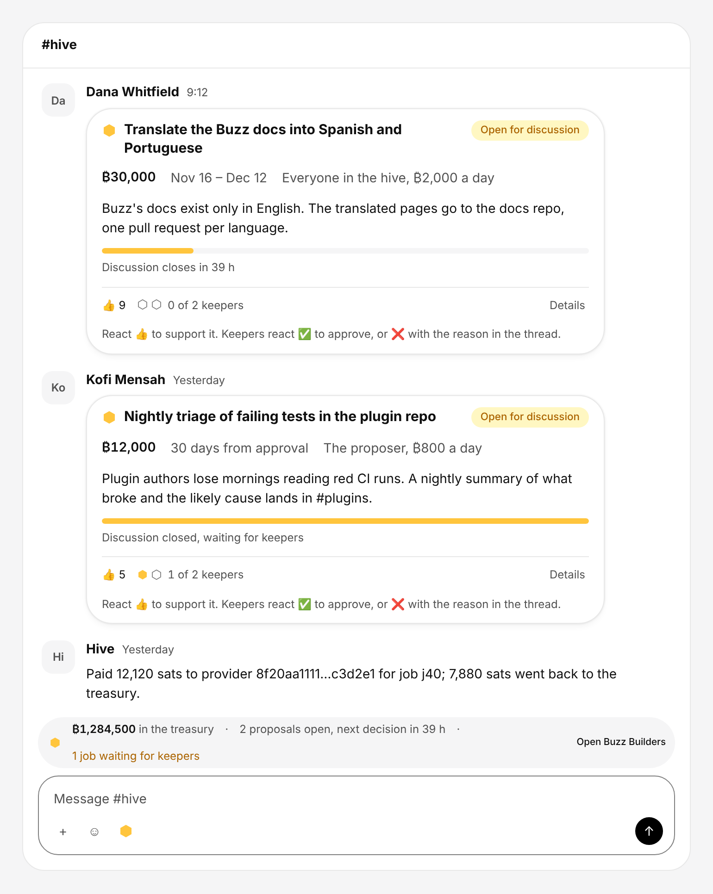
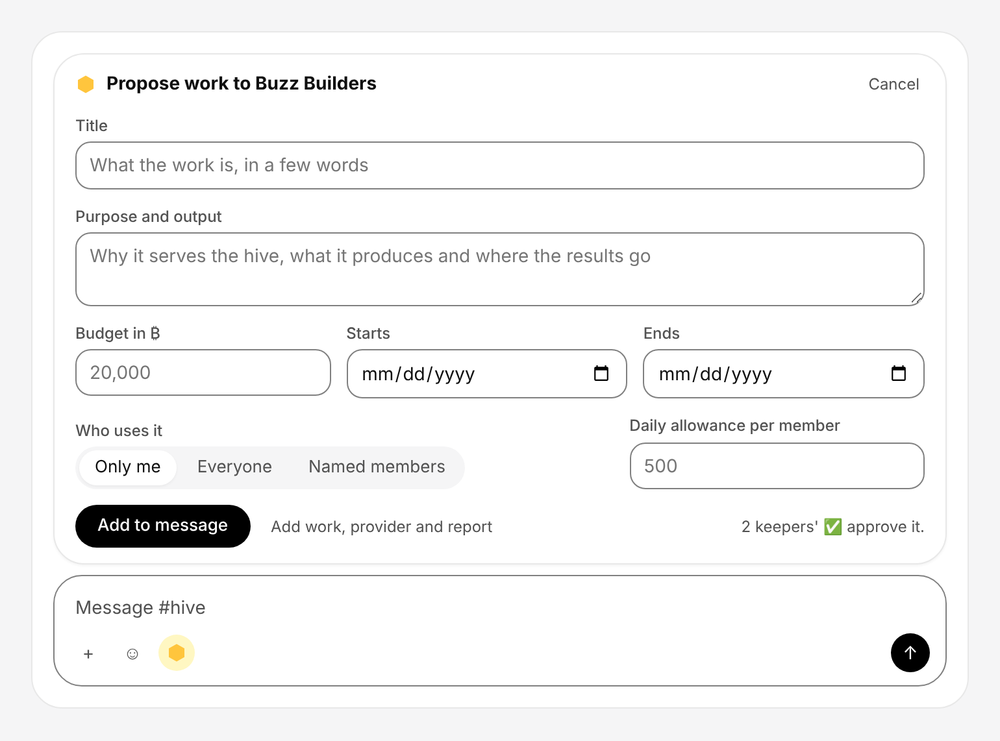
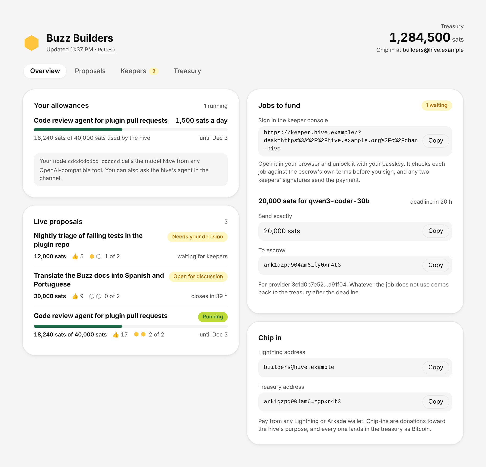
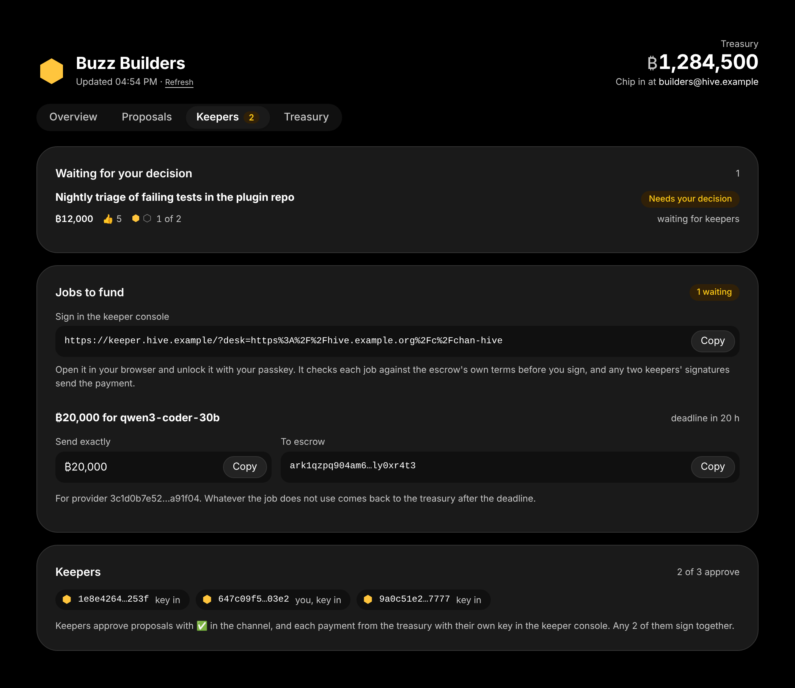
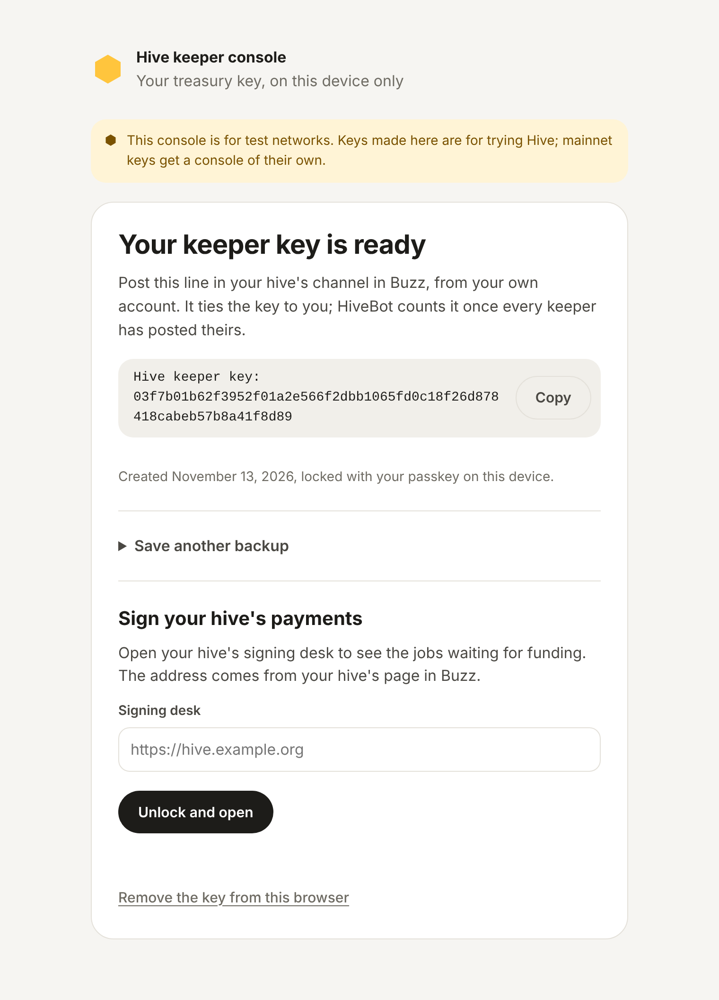
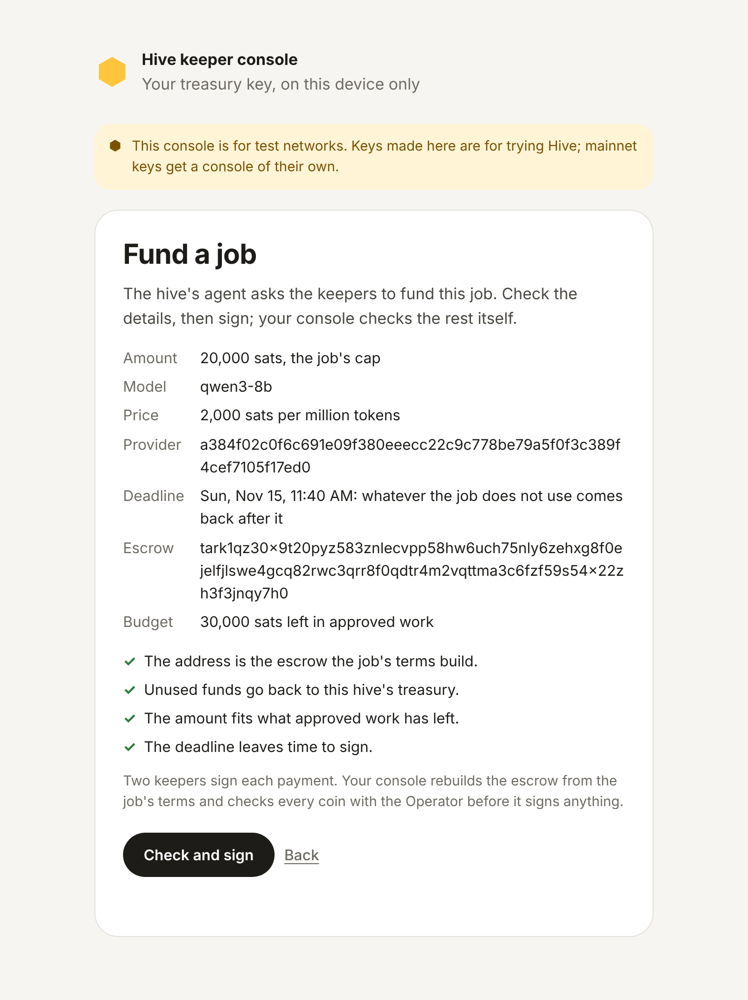

# Hive

Hive is a proof of concept for a Bitcoin treasury that a Buzz community keeps together and spends on
AI inference served over MeshLLM. Members chip in from any Lightning wallet through the hive's
Lightning address, or from any Arkade wallet straight to its treasury. They propose work in the
hive's Buzz channel and approve it with reactions. When a member asks the hive's model, the hive's agent
buys the answer from an independent provider, three keepers chosen by the community hold the
treasury's keys, and any two of them sign each job's payment from their own devices. The provider
is paid for exactly the tokens it served, against receipts the agent signs as the answers come back,
and whatever a job leaves unused goes back to the treasury, at its deadline if nobody claims it,
with nobody signing.

## Status

I built this to show that a community treasury paying for AI can be done with Buzz and Arkade, and
it works: the whole flow, from HiveBot setting a hive up in its channel to a provider paid and the
remainder back in the treasury, runs end to end on a local regtest stack, with the keepers'
consoles in a real browser, for a hive whose agent runs on the host as well as for one that brings
its own node. The escrow behind each job has claimed and returned on mainnet with small amounts.
The rest has never run end to end on mainnet.

It is a proof of concept and was built quickly, largely with AI coding tools, so it is vibecoded in
places. I am not going to keep developing it. If your community wants to take it further, fork it:
with some dirty work it can run, and with real interest it can grow into something sturdier. Read
it and test it before trusting it with funds that matter.

The known gaps are the ones you would expect at this stage. A hive on the Hive service gets no
Lightning address yet, so its members chip in from an Arkade wallet until the service registers one
the way `pnpm ops init --lnurl` does for a hive on its own host. Keepers can fund jobs and nothing else,
so there is no keeper-signed withdrawal, no tooling for the exit path, for replacing a keeper or for
winding a hive down. The keeper console is reproducible and hashed, though it is not published as a
signed release. The signing desk answers anyone who asks it, the buyer trusts the usage a provider
reports for each answer, and member allowances are counted without a lock. Pages and the desk
rebuild their view from disk on every request, the services run from a git checkout with little
logging, and CI does not run the test suites. Mainnet sits behind an explicit opt-in, with the
Operator and Emulator pinned in the code and hard ceilings on escrows, chip-ins and treasury size.

## The Buzz plugin

Most of the work went into making a hive feel native to Buzz, so that a community runs it from the
channel it already talks in. The plugin is a Buzz 1.0 plugin that holds no keys and asks for one
network origin, the host it reads the hive from. It builds on the plugin APIs Buzz is opening up:
message renderers, composer tools and accessories, pages, agent tools, notifications and the
community connection Buzz already has. It draws with Buzz's own design tokens, so it follows the
app's light and dark themes.

<p>


</p>

In the hive's channel, a proposal is an ordinary message that any Buzz client can read and write,
and the plugin draws it as a card with its budget, period and allowance, the discussion's progress
and live 👍 and ✅ counts. A status line above the composer shows the treasury, the open proposals
with the next decision, and any job waiting for keepers. The Propose button opens a short form that
writes the proposal into the message box, and the member sends it themselves. The plugin works out
where each proposal stands on its own, reading the channel's messages, reactions and deletions
through the community connection and applying the hive's rules, so proposals, approvals and
allowances work as soon as it is installed. It also forwards the channel's signed events to the
hive's host, which therefore needs no Buzz identity of its own and checks every signature itself.

<p>


</p>

The hive's page has four tabs. The overview shows the treasury, the viewer's own allowances and
the live proposals; the proposals tab lists every proposal; the keepers tab shows what waits for a
keeper's decision, the jobs to fund with a link that opens the keeper console on the hive's signing
desk, and which keepers have posted their keys; and the treasury tab shows chip-ins, payouts, jobs
and providers.

The plugin also defines HiveBot, an agent the community owner creates on Buzz's Agents page, which
needs no model and keeps nothing on disk. Mentioned with "set up with 3 keepers", it takes the
channel through the hive's setup: it asks for keepers, has the owner confirm them, acknowledges each
keeper's key and each member's node, and later posts decisions, payouts and chip-ins as they happen.
For questions it can bring in a guide, a Goose agent on Buzz's own harness, and every agent in the
community gets four tools from the plugin (`hive_guide`, `hive_proposals`, `hive_status` and
`hive_docs`) that answer from the hive's live state and its documentation.

<p>


</p>

Signing happens outside Buzz, in the keeper console, a single page where each keeper makes their
treasury key behind a passkey on their own device, saves an encrypted backup, and later checks and
signs each payment against the escrow's own terms. One plugin build serves every hive on a Hive
service and finds its own by the channel it sits in. The plugin screenshots are its own components
rendered with sample data and Buzz's tokens by `hive/hive-buzz/test/preview.mjs`, the console's
come from `test/keeper-console-e2e.ts` with `HIVE_SHOTS` set, and
[the plugin's README](hive/hive-buzz/README.md) covers it in full. Buzz describes its conversation
hooks as a preview rather than a stable interface, so a new Buzz release may ask for adjustments.

## How it fits together

- **[`hive/hive-buzz`](hive/hive-buzz/README.md)** is the Buzz side: the plugin, HiveBot and the
  keeper console described above, and hive-api for a hive on a host of its own.
- **[`hive/pay-arkade`](hive/pay-arkade/README.md)** is the MeshLLM side: a plugin through which a
  provider is paid per token from an escrow on Arkade, with the agent signing a receipt after every
  answer.
- **The Hive service** (`tools/service.ts`, run with `pnpm ops service`) carries any number of hives
  for the communities that use it: it reads each hive's channel as members' plugins forward it,
  builds the treasury from the keepers' keys, runs the signing desk and, if asked, each hive's agent
  node. It holds no key that moves funds.
- **The contracts and the signing code** (`packages/`, `contracts/`) hold the money and decide what
  signatures can move it.

## Running it yourself

[Running Hive for a Buzz community](docs/self-hosting.md) sets up a host (the service, the delegatee
and the keeper console, with `deploy/setup.sh`), the MeshLLM nodes, and walks one hive from setup to
a paid job. It also shows how to rehearse the whole flow on a local regtest stack first.

## Getting started

You need Node 22 or later and pnpm 10 (`corepack enable` picks up the pinned
version). `pnpm vectors:check` also needs Go 1.26, and the MeshLLM tools need
Python 3.

```bash
pnpm install
pnpm check                 # format, lint, typecheck and every test, none skipped
pnpm dev                   # the site with three sample hives at http://127.0.0.1:8790/
pnpm gates:offline         # the three gates against the in-memory network
pnpm audit:v4 --offline    # recheck the evidence those gates wrote
```

Everything above runs without a network and moves no value. The offline gates
write under `.local/offline-evidence/`; the lifecycle gate takes about four
minutes because it waits out an unused escrow's deadline. The Buzz plugin has
its own tests (`npm install && npm test` in `hive/hive-buzz`), and pay-arkade
builds and tests with Cargo and Bun as [its README](hive/pay-arkade/README.md)
describes.

## The foundation

Hive began as a hive hosted on its own website, with chip-ins over Lightning and jobs bought over
Nostr, and the Buzz and MeshLLM path is built on the same contracts and signing code. That earlier
system is still here and still tested, and the sections below describe it.

### A job from start to finish

1. **Chip in.** Contributions arrive at the hive's Lightning address or as a
   transfer to its Arkade address. The hive credits a contribution once it
   observes the output, and the audit on its page accounts for every coin.
2. **Approve.** Each keeper approves the exact terms of a purchase: provider,
   model, cap and deadline. The provider and the buyer approve the same terms.
3. **Quote.** The hive asks the provider's solver over Nostr. The signed quote
   names the treasury, the keepers' keys, the cap, the deadline and the rates,
   and its digest becomes the escrow's id.
4. **Fund.** Two keepers sign to move exactly the cap from the treasury into an
   escrow built for that quote. Its refund at the deadline is arranged
   before a single sat moves.
5. **Meter.** The buyer's agent, an OpenAI-compatible proxy, signs a cumulative
   receipt for every response the provider's metering sidecar serves. A
   response is released once its usage and receipt are final.
6. **Claim or refund.** The provider claims the latest receipt before the
   deadline: the escrow pays the provider's wallet and returns the rest to the
   treasury. An escrow nobody claims returns whole once the deadline passes.

The provider can cash out to any Lightning invoice through a swap solver, or
sweep its wallet to an Arkade address.

### Safeguards

The treasury, every job's escrow and every provider's wallet are Bitcoin
outputs locked by rules that hold whoever runs the server:

- One keeper alone moves nothing. Two keepers can fund only a job both of
  them approved, for exactly its cap.
- A job's escrow pays out one of two ways. Before the deadline the provider
  can take the amount on the buyer's latest signed receipt, up to the cap,
  with the rest going back to the hive. After the deadline the whole escrow
  goes back to the hive.
- That refund needs nobody's signature, so it happens even when every keeper
  and the server are offline.
- Every payment is written down before it is sent, so sending it again never
  pays twice.
- Nothing counts as received, paid or settled until the coin itself is seen.

[How Hive works](docs/system.md) draws the whole flow, from chip-in to
cash-out.

### Hives and hosts

One server can host many hives, each at `/h/<hive>/` with its own treasury,
records, payment requests, claim queue and halt switch. The directory at `/`
lists every hive under a listing its three keepers signed, with its name,
purpose, keeper keys, treasury and Lightning address. The host refuses a
listing a keeper never signed, two hives with one name and two hives with one
treasury. A host holds no key: while it is down its hives take no
contributions and open no jobs, and deadline refunds still happen. A hive
that wants its own server runs the same code alone.

A hive's keepers hold their own keys. Each makes theirs in the keeper console
on their own device, locked with a passkey, and posts its public key in the
hive's channel; `pnpm ops init --keepers` builds the treasury from the three
keys and keeps none of them. Each payment then waits at the hive's signing desk
(`pnpm ops desk`) until two keepers have checked and signed it in their
consoles, hours apart if they like. Without `--keepers`, `pnpm ops init` still
makes all three keys in the operator's checkout, for the gates and for trying
Hive alone.

### Working on the site

`pnpm dev` runs the site on your machine with three sample hives, at
`http://127.0.0.1:8790/` (`--port` picks another). The directory of hives is
`app/hives.html` and a hive's page is `app/page.html`. Each is one file with
its styles and script inline, and the server reads both from disk on every
request, so a saved edit shows when you refresh the browser.

The sample hives live in `tools/dev.ts`. Change a balance, add a job or add a
hive there to see the pages in other states; `pnpm dev` restarts itself when a
TypeScript file changes. Every key, coin and job is made up each time it
starts, nothing reaches a network, and chip-in stays closed.

The pages load nothing from other sites, and the server's content policy
blocks anything that tries. Typefaces live in `app/fonts/` and are served by
`app/server.ts`, which is also where a new image or file would get its route.

### Running a hive

`pnpm ops` runs hives from a checkout on regtest or Mutinynet. Its records go
under `.local/ops/<hive>/` and its keys under `.secrets/`, both ignored by git.

| Command | Does |
| --- | --- |
| `pnpm ops init <hive> --network <regtest\|mutinynet> [--keepers <k1,k2,k3>]` | Builds the treasury and the Lightning address, from the keepers' own keys or from three made here |
| `pnpm ops listing <hive> --name <name> [--purpose <text>]` | Writes the hive's listing, signed by its three keepers |
| `pnpm ops publish <hive> --relay <url>` | Publishes that listing to Nostr relays, so other sites and providers can find the hive |
| `pnpm ops hives --network <regtest\|mutinynet> --relay <url>` | Lists the hives those relays carry, keeping only listings whose keys build the treasury they name |
| `pnpm ops provider-add <hive> <provider> …` | Creates a provider with its payout wallet, card and solver configuration |
| `pnpm ops approve <hive> <label> --provider … --cap … --minutes …` | Approves one purchase's exact terms for every party |
| `pnpm ops buy <hive> <label>` | Gets the quote, arranges the refund and funds the escrow |
| `pnpm ops serve <hive>` / `pnpm ops host <hive> …` | Serves one hive, or several under one directory, with the claim desk at `/api/claim` |
| `pnpm ops desk <hive> --agent-log <log> [--governance <file>]` | Runs the signing desk, where keepers' consoles sign each payment |
| `pnpm ops status <hive>` | Prints the hive's balance, jobs and warnings |
| `pnpm ops halt [--hive <hive>] <reason>` / `pnpm ops resume …` | Stops or restarts new jobs and contributions, for one hive or all of them |

[Running Hive](docs/running.md) lists every command and what a test
network needs.

## Networks

| Network | Runs on | Needs |
| --- | --- | --- |
| Regtest | A local test stack | The services listed in [running Hive](docs/running.md) |
| Mutinynet | Ark Labs' public test network | `BUZZ_MUTINYNET=approved` for each run |
| Bitcoin | Ark Labs' Operator at arkade.computer | `BUZZ_MAINNET=enabled`, and the delegatee the hive's server runs: `BUZZ_DELEGATEE_URL` and `BUZZ_DELEGATE_KEY` |

On mainnet the Operator's and the Emulator's keys are pinned in the code, and
the delegate key is pinned by the server that runs the delegatee. Only a
keepers' hive runs there: no keeper key for real funds is made or kept by the
tools. Mainnet also keeps hard ceilings on escrows, contributions and
treasury size.

## Repository

| Path | Holds |
| --- | --- |
| `packages/kit` | Faults, validation, local state and locks, workers, HTTP helpers, the halt switch |
| `packages/protocol` | Canonical JSON, quotes, receipts, RFQ envelopes, hive listings, BOLT11 decoding |
| `packages/executor` | Builds and submits each transaction |
| `packages/ark` | The contracts, their addresses, and the plans for sends, claims and refunds |
| `packages/steward` | The keeper's signing worker and its policy |
| `packages/hive` | The hive: quotes, purchases, sends, claims, refunds, withdrawals, contributions and its view |
| `packages/provider` | RFQ solver, metering sidecar, claim daemon and Lightning cash-out |
| `packages/agent` | The buyer's OpenAI-compatible receipt proxy |
| `app/` | The server, the directory (`hives.html`), a hive's page (`page.html`) and its typefaces |
| `contracts/v4/` | The treasury, escrow, wallet and boarding contracts |
| `gates/` | The lifecycle, refusals and renewal gates |
| `tools/` | `ops.ts`, the Hive service (`service.ts`), the signing desk (`desk.ts`), the agent nodes (`agents.ts`), the local site (`dev.ts`), backups, the audit and the test vector generators |
| `test/` | Integration and architecture tests over an in-memory network |
| `docs/` | How the system works, how to run it and host it, and the agent's API |
| `hive/pay-arkade/` | The MeshLLM payment plugin, its escrow contract and its gates |
| `hive/hive-buzz/` | The Buzz plugin, HiveBot, the keeper console and hive-api |
| `deploy/` | Setup for a self-hosted host: the service, the delegatee, the console, TLS and backups |

`test/architecture.test.ts` enforces which package may import which.

## Contributing

- Branch from `main`, and commit only when `pnpm check` passes with zero
  skips.
- A change to a contract or to how a transaction is built changes addresses or
  txids: regenerate the vectors and run `pnpm vectors:check`.
- Keys, tokens and nonces never enter git, logs or evidence.

## License

Hive is released under the [MIT License](LICENSE). The typefaces in
`app/fonts/` are under the SIL Open Font License, with their license files
beside them.
