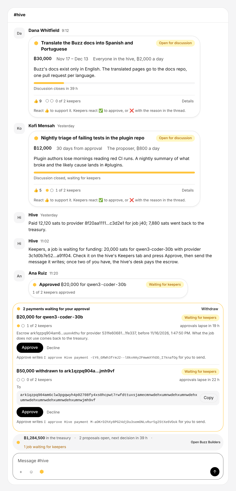
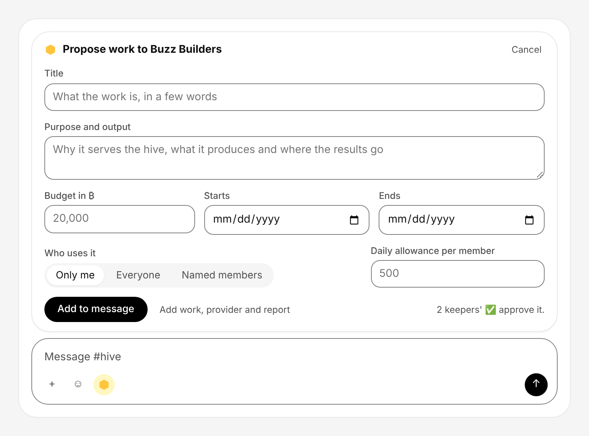
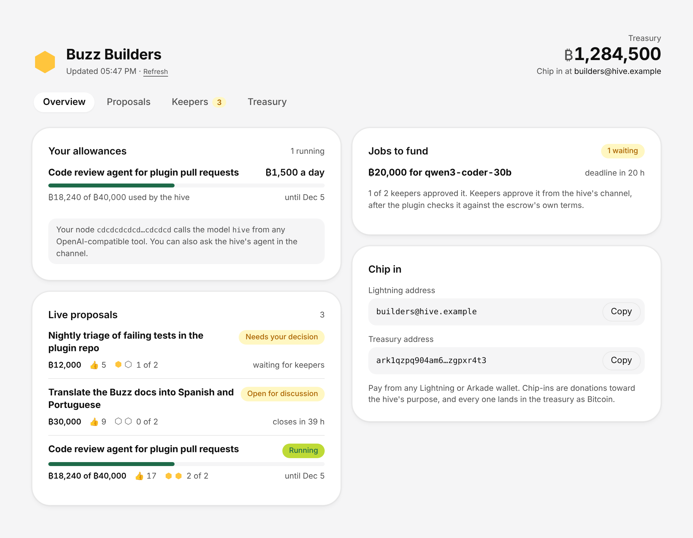
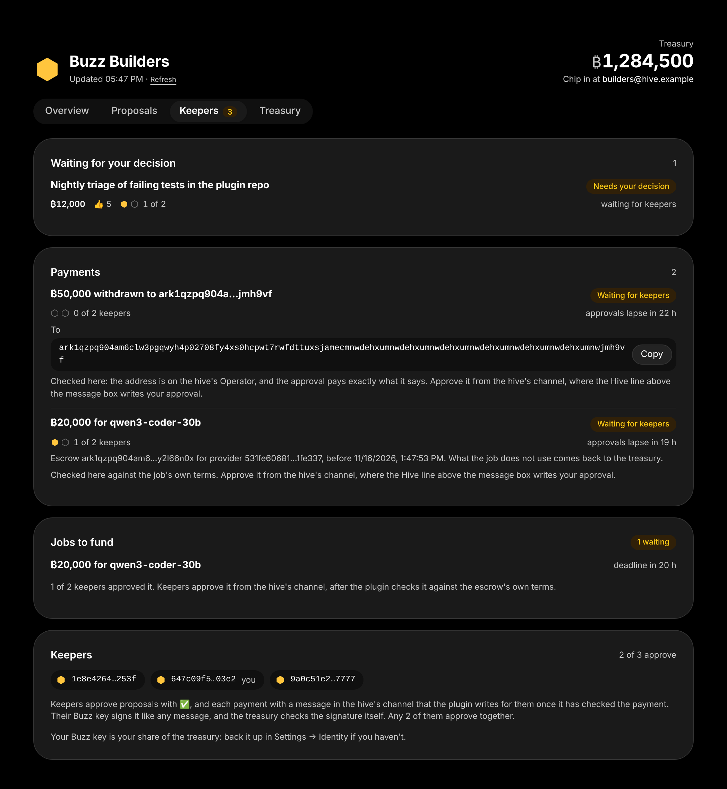
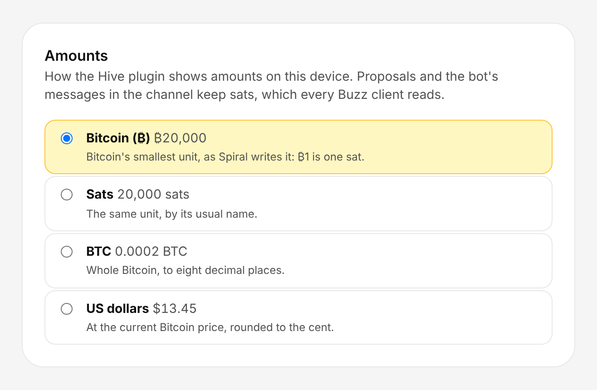

<h1>
  <picture>
    <source media="(prefers-color-scheme: dark)" srcset="docs/images/hive-logo-dark.svg">
    
  </picture>
</h1>

Hive is a proof of concept for a Bitcoin treasury that a Buzz community keeps together and spends on
AI inference served over MeshLLM. Members chip in from any Lightning wallet through the hive's
Lightning address, or from any Arkade wallet straight to its treasury. They propose work in the
hive's Buzz channel and approve it with reactions. When a member asks the hive's model, the hive's agent
buys the answer from an independent provider, three keepers chosen by the community hold the
treasury together through their own Buzz accounts, and any two of them approve each job's payment
with a message in the channel. The provider
is paid for exactly the tokens it served, against receipts the agent signs as the answers come back,
and whatever a job leaves unused goes back to the treasury, at its deadline if nobody claims it,
with nobody signing.

## Status

I built this to show that a community treasury paying for AI can be done with Buzz and Arkade, and
it works: the whole flow, from HiveBot setting a hive up in its channel to a provider paid and the
remainder back in the treasury, has run end to end on a local regtest stack, for a hive whose agent
runs on the host as well as for one that brings its own node. The v5 treasury, which keepers approve
from Buzz itself, is new: its contract, the host's approvals desk and the Hive plugin have run end to
end on regtest, from the keepers' Buzz keys to a funded escrow and a withdrawal, while the full
rehearsal with MeshLLM nodes has not been run again since keepers began approving from Buzz. The
escrow behind each job has claimed and returned on mainnet with small amounts. The rest has never
run end to end on mainnet.

It is a proof of concept and was built quickly, largely with AI coding tools, so it is vibecoded in
places. I am not going to keep developing it. If your community wants to take it further, fork it:
with some dirty work it can run, and with real interest it can grow into something sturdier. Read
it and test it before trusting it with funds that matter.

The known gaps are the ones you would expect at this stage. A hive on the Hive service gets no
Lightning address yet, so its members chip in from an Arkade wallet until the service registers one
the way `pnpm ops init --lnurl` does for a hive on its own host. Keepers can fund jobs and withdraw
to an Arkade address two of them agree on, which is how a hive moves or winds down, and that is
all: there is no tooling for the exit path or for replacing a keeper, and a v5 treasury does not
sign the hive's directory listing yet. A keeper's Hive plugin checks every payment's escrow,
recipient and amount itself, yet it takes what approved work has left from the desk, which it cannot
check against the channel. A keeper's key is the software key Buzz keeps for their account, not one
bound to their device's hardware: whoever holds it, through Buzz's key backup if the keeper turned it
on for instance, approves as that keeper, and approving asks for no fingerprint or face. An approval
cannot be taken back once it is sent; it lapses at its time. A host that is forwarded a channel cannot see who is in
it, so it keeps strangers' events apart from the hive's own instead of refusing them. The buyer
signs for the usage a provider reports only as far as the request itself could have gone, and
within that it still takes the provider's count. The services run from a git checkout, and on a
host every hive's agent node runs as the same user as the service. Mainnet sits behind an explicit
opt-in, with the Operator and Emulator pinned in the code and hard ceilings on escrows, chip-ins and
treasury size. [SECURITY.md](SECURITY.md) says what each part is trusted with.

## The Buzz plugin

Most of the work went into making a hive feel native to Buzz, so that a community runs it from the
channel it already talks in. The plugin is a Buzz 1.0 plugin that holds no keys and asks for one
network origin, the host it reads the hive from. It builds on the plugin APIs Buzz is opening up:
message renderers, composer tools and accessories, pages, agent tools, notifications and the
community connection Buzz already has. It draws with Buzz's own design tokens, so it follows the
app's light and dark themes.

<p>


</p>

In the hive's channel, a proposal is an ordinary message that any Buzz client can read and write,
and the plugin draws it as a card with its budget, period and allowance, the discussion's progress
and live 👍 and ✅ counts. A status line above the composer shows the treasury, the open proposals
with the next decision, and any job waiting for keepers. The Propose button opens a short form that
writes the proposal into the message box, and the member sends it themselves. The plugin works out
where each proposal stands on its own, reading the channel's messages, reactions and deletions
through the community connection and applying the hive's rules, so proposals, approvals and
allowances work as soon as it is installed. It also forwards the channel's signed events to the
hive's host, which therefore needs no Buzz identity of its own and checks every signature itself.

<p>


</p>

The hive's page has four tabs. The overview shows the treasury, the viewer's own allowances and
the live proposals; the proposals tab lists every proposal; the keepers tab shows what waits for a
keeper's decision, the payments waiting for keepers' approvals, each checked by the plugin itself,
and the jobs to fund; and the treasury tab shows chip-ins, payouts, jobs and providers. In the
hive's channel, a keeper finds the same payments above the message box, with Approve and Decline.

The plugin also defines HiveBot, an agent the community owner creates on Buzz's Agents page, which
needs no model and keeps nothing on disk. Mentioned with "set up with 3 keepers", it takes the
channel through the hive's setup: it asks for keepers, has the owner confirm them, acknowledges each
member's node, and later posts decisions, payouts and chip-ins as they happen.
For questions it can bring in a guide, a Goose agent on Buzz's own harness, and every agent in the
community gets four tools from the plugin (`hive_guide`, `hive_proposals`, `hive_status` and
`hive_docs`) that answer from the hive's live state and its documentation.

<p>

</p>

Each member chooses how amounts read in the plugin's card in Buzz's Settings. The default follows
[Spiral's proposal](https://spiralxyz.substack.com/p/bringing-to-the-world) to write Bitcoin's
smallest unit with the ₿ sign, so ₿1 is one sat and a job's cap reads ₿20,000; sats, whole BTC and
US dollars at the current price are the alternatives. Only the display changes: proposals, the bot's messages and the agents' tools keep sats, the unit
every Buzz client reads, and an amount a keeper signs for always shows to the sat.

One plugin build serves every hive on a Hive service and finds its own by the channel it sits in.
The plugin screenshots are its own components rendered with sample data and Buzz's tokens by
`hive/hive-buzz/test/preview.mjs`, and [the plugin's README](hive/hive-buzz/README.md) covers it in
full. Buzz describes its conversation hooks as a preview rather than a stable interface, so a new
Buzz release may ask for adjustments.

## Keepers and their approvals

The treasury belongs to three keepers the community chooses in its channel, and nobody else ever
holds their keys: not the host, not HiveBot, not the agent. A keeper's key is their Buzz account's
own, the key Buzz already keeps for them and signs every message they send with, so becoming a
keeper creates nothing and there is nothing to copy. HiveBot asks the channel who will keep the
treasury, three members react ✅ and the founder confirms them. The ✅ each keeper signed names their
key, and the host builds the treasury from the three without keeping any of them. A keeper backs the
key up in Buzz's Settings → Identity, since it is now also their share of the treasury and the key
on its exit.

### From a Buzz identity to the treasury

A Buzz identity is a secp256k1 key pair, the kind Nostr uses. The Buzz app makes its secret once,
when the member creates their identity, from 32 random bytes of the operating system's generator,
or takes the one they import as an `nsec`. It keeps that secret in the system's secure storage and
signs every event with it. The public half is the x-only key BIP340 defines: 32 bytes that Buzz
writes as 64 hex characters in each event's `pubkey` and shows as an `npub`. No seed phrase,
password or server goes into it, and Hive derives no new secret from it: a keeper's treasury key is
exactly the secret of their Buzz identity.

The host learns the three keys from signed events alone. Each keeper's ✅ on HiveBot's call is an
event signed with their key, whose `pubkey` is that key, and HiveBot's message announcing the
keepers names them in its `p` tags, in the order the founder confirmed them. The service checks
every signature, takes the keys in that order and writes them into the treasury's terms in three
forms:

- `keeperA`, `keeperB` and `keeperC` are the x-only keys themselves, against which `pay` checks each
  approval's BIP340 signature.
- `hexA`, `hexB` and `hexC` are the same keys as 64 lowercase hex characters, the bytes each one
  takes in the event serialization the covenant rebuilds.
- `pair01`, `pair02` and `pair12` are one key per pair of keepers, for the exit path. Each keeper's
  x-only key is lifted to the 33-byte compressed key of its even point, `02` followed by the key, as
  BIP340 reads it; the pair's two keys are sorted, and BIP327 MuSig2 key aggregation turns them into
  one key that owns the pair's exit leaf. The two keepers would sign with it together, each with
  their own Buzz secret, though nothing in this repository signs an exit yet.

Together with the hive's counter, the host's delegate key, the renewal and fee limits, and the
Arkade Operator's and Emulator's keys and exit delay, these terms fix the treasury's script and
therefore its address, so anyone holding the three public keys rebuilds the same treasury:
`pnpm ops init --keepers` does exactly that from three npubs
([`packages/treasury/src/terms.ts`](packages/treasury/src/terms.ts),
[`packages/ark/src/musig.ts`](packages/ark/src/musig.ts)). A keeper's Hive plugin, for its part,
refuses a payment from a host that names other keepers than the channel confirmed.

The Buzz identity and the keeper's share of the treasury are therefore one and the same. A keeper
who moves to a new Buzz identity is no longer a keeper of this treasury, whoever imports their
`nsec` into another Buzz app approves as them, and a keeper who loses it with no copy loses their
share. Settings → Identity in Buzz reveals and copies the private key, and Buzz's optional key
backup can keep a sealed copy of it; each keeper should have one or the other before the treasury
holds anything.

The treasury is a covenant on Arkade that checks the keepers' approvals itself
([`contracts/v5`](contracts/v5/README.md)). A keeper approves a payment by sending a message in the
hive's channel, `I approve Hive payment <code>`, whose code names the treasury, the payment's
number, its amount, its recipient and the time the approval lapses. Buzz signs that message as it
signs any other. The covenant rebuilds it from the keeper's key, the code and the two parts Buzz
chooses itself, its time and its tags, and verifies the keeper's signature over it, so a payment
spends the treasury only with two such messages, sent from any device at any time and in any order.
No keeper waits on another, and nothing passes between them. The payment's number is the hive's
counter, an asset the host issues once and sends whole to the treasury, of which each payment burns
one unit. An approval therefore pays once, and a member's chip-in or an escrow's remainder, which the
desk folds into the treasury coin, leaves every pending approval valid. So does the delegatee's
renewal of the treasury into a new batch, which the treasury pays for itself, up to a cap, and which
no one but the host's delegatee may cosign.

Keepers never type a code. When the agent asks for a job to be funded, the hive's approvals desk on
the host makes it a payment, and each keeper's Hive plugin shows it above the message box in the
hive's channel, with Approve and Decline. Before it offers either, the plugin rebuilds the job's
escrow from its terms with the hive's own code, bundled into the plugin, checks that the escrow pays
back to this treasury and that the amount is the job's cap, and rebuilds the exact message the
covenant will check; on mainnet it also holds the host to the Arkade Operator's and Emulator's keys
it was built with. Approve writes that message into the message box for the keeper to send, and
Decline writes the one that stops the payment. In the channel, each approval draws as a card naming
the payment it approves. Once two keepers have approved, the desk, which follows the channel as
members' plugins forward it, submits the payment through the Emulator, and should its answer be
lost, submitting again is safe: the covenant pays each approval once. A keeper asks for a withdrawal
the same way, with the plugin's Withdraw form or a message `Hive withdrawal: <amount> sats to
<Arkade address>`, and two keepers approve it like any payment. The whole of it runs on regtest with
the plugin itself, from the keepers' Buzz keys to a funded escrow and a withdrawal
(`test/buzz-approvals-e2e.ts`).

## How it fits together

- **[`hive/hive-buzz`](hive/hive-buzz/README.md)** is the Buzz side: the plugin and HiveBot
  described above, and hive-api for a hive on a host of its own.
- **[`hive/pay-arkade`](hive/pay-arkade/README.md)** is the MeshLLM side: a plugin through which a
  provider is paid per token from an escrow on Arkade, with the agent signing a receipt after every
  answer.
- **The Hive service** (`tools/service.ts`, run with `pnpm ops service`) carries any number of hives
  for the communities that use it: it reads each hive's channel as members' plugins forward it,
  builds the treasury from the keepers' Buzz keys, issues its counter, runs the approvals desk that
  follows the keepers' approvals in the channel and, if asked, each hive's agent node. It holds no
  key that moves funds.
- **The contracts and the signing code** (`packages/`, `contracts/`) hold the money and decide what
  signatures can move it; `packages/treasury` is what the v5 treasury's keepers approve, shared by
  the service and the plugin.

## Running it yourself

[Running Hive for a Buzz community](docs/self-hosting.md) sets up a host (the service and the
delegatee, with `deploy/setup.sh`), the MeshLLM nodes, and walks one hive from setup to
a paid job. It also shows how to rehearse the whole flow on a local regtest stack first.

## Getting started

You need Node 22 or later and pnpm 10 (`corepack enable` picks up the pinned
version). `pnpm vectors:check` also needs Go 1.26, and the MeshLLM tools need
Python 3.

```bash
pnpm install
pnpm check                 # format, lint, typecheck and every test, none skipped
pnpm dev                   # the site with three sample hives at http://127.0.0.1:8790/
pnpm gates:offline         # the three gates against the in-memory network
pnpm audit:v4 --offline    # recheck the evidence those gates wrote
```

Everything above runs without a network and moves no value. The offline gates
write under `.local/offline-evidence/`; the lifecycle gate takes about four
minutes because it waits out an unused escrow's deadline. The Buzz plugin has
its own tests (`npm install && npm test` in `hive/hive-buzz`), and pay-arkade
builds and tests with Cargo and Bun as [its README](hive/pay-arkade/README.md)
describes.

## The foundation

Hive began as a hive hosted on its own website, with chip-ins over Lightning and jobs bought over
Nostr, and the Buzz and MeshLLM path is built on the same contracts and signing code. That earlier
system is still here and still tested, and the sections below describe it.

### A job from start to finish

1. **Chip in.** Contributions arrive at the hive's Lightning address or as a
   transfer to its Arkade address. The hive credits a contribution once it
   observes the output, and the audit on its page accounts for every coin.
2. **Approve.** Each keeper approves the exact terms of a purchase: provider,
   model, cap and deadline. The provider and the buyer approve the same terms.
3. **Quote.** The hive asks the provider's solver over Nostr. The signed quote
   names the treasury, the keepers' keys, the cap, the deadline and the rates,
   and its digest becomes the escrow's id.
4. **Fund.** Two keepers sign to move exactly the cap from the treasury into an
   escrow built for that quote. Its refund at the deadline is arranged
   before a single sat moves.
5. **Meter.** The buyer's agent, an OpenAI-compatible proxy, signs a cumulative
   receipt for every response the provider's metering sidecar serves. A
   response is released once its usage and receipt are final.
6. **Claim or refund.** The provider claims the latest receipt before the
   deadline: the escrow pays the provider's wallet and returns the rest to the
   treasury. An escrow nobody claims returns whole once the deadline passes.

The provider can cash out to any Lightning invoice through a swap solver, or
sweep its wallet to an Arkade address.

### Safeguards

The treasury, every job's escrow and every provider's wallet are Bitcoin
outputs locked by rules that hold whoever runs the server:

- One keeper alone moves nothing. Two keepers can fund a job both of them
  approved, for exactly its cap, or withdraw to an address both of them
  checked in their own plugin.
- A job's escrow pays out one of two ways. Before the deadline the provider
  can take the amount on the buyer's latest signed receipt, up to the cap,
  with the rest going back to the hive. After the deadline the whole escrow
  goes back to the hive.
- That refund needs nobody's signature, so it happens even when every keeper
  and the server are offline.
- Every payment is written down before it is sent, so sending it again never
  pays twice.
- Nothing counts as received, paid or settled until the coin itself is seen.

[How Hive works](docs/system.md) draws the whole flow, from chip-in to
cash-out.

### Hives and hosts

One server can host many hives, each at `/h/<hive>/` with its own treasury,
records, payment requests, claim queue and halt switch. The directory at `/`
lists every hive under a listing its three keepers signed, with its name,
purpose, keeper keys, treasury and Lightning address. The host refuses a
listing a keeper never signed, two hives with one name and two hives with one
treasury. A host holds no key: while it is down its hives take no
contributions and open no jobs, and deadline refunds still happen. A hive
that wants its own server runs the same code alone.

A hive's keepers hold their own keys: their Buzz accounts' keys, from which
the Hive service builds the v5 treasury, keeping none of them. Each payment
then waits at the hive's approvals desk until two keepers have checked it in
their plugin and approved it with a message in the channel, hours apart if they
like. `pnpm ops init --keepers` builds the same treasury from three keepers'
Buzz keys, npubs or hex; given three compressed keys instead, it builds the v4
treasury of earlier hives, whose keepers sign with MuSig2 keys of their own. Without `--keepers`, `pnpm ops init` still
makes all three keys in the operator's checkout, for the gates and for trying
Hive alone.

### Working on the site

`pnpm dev` runs the site on your machine with three sample hives, at
`http://127.0.0.1:8790/` (`--port` picks another). The directory of hives is
`app/hives.html` and a hive's page is `app/page.html`. Each is one file with
its styles and script inline, and the server reads both from disk on every
request, so a saved edit shows when you refresh the browser.

The sample hives live in `tools/dev.ts`. Change a balance, add a job or add a
hive there to see the pages in other states; `pnpm dev` restarts itself when a
TypeScript file changes. Every key, coin and job is made up each time it
starts, nothing reaches a network, and chip-in stays closed.

The pages load nothing from other sites, and the server's content policy
blocks anything that tries. Typefaces live in `app/fonts/` and are served by
`app/server.ts`, which is also where a new image or file would get its route.

### Running a hive

`pnpm ops` runs hives from a checkout on regtest or Mutinynet. Its records go
under `.local/ops/<hive>/` and its keys under `.secrets/`, both ignored by git.

| Command | Does |
| --- | --- |
| `pnpm ops init <hive> --network <regtest\|mutinynet> [--keepers <k1,k2,k3>]` | Builds the treasury and the Lightning address, from the keepers' own keys or from three made here |
| `pnpm ops listing <hive> --name <name> [--purpose <text>]` | Writes the hive's listing, signed by its three keepers |
| `pnpm ops publish <hive> --relay <url>` | Publishes that listing to Nostr relays, so other sites and providers can find the hive |
| `pnpm ops hives --network <regtest\|mutinynet> --relay <url>` | Lists the hives those relays carry, keeping only listings whose keys build the treasury they name |
| `pnpm ops provider-add <hive> <provider> …` | Creates a provider with its payout wallet, card and solver configuration |
| `pnpm ops approve <hive> <label> --provider … --cap … --minutes …` | Approves one purchase's exact terms for every party |
| `pnpm ops buy <hive> <label>` | Gets the quote, arranges the refund and funds the escrow |
| `pnpm ops serve <hive>` / `pnpm ops host <hive> …` | Serves one hive, or several under one directory, with the claim desk at `/api/claim` |
| `pnpm ops desk <hive> --agent-log <log> --events <file> [--governance <file>] [--payments-file <file>]` | Runs a v5 hive's approvals desk, which follows the keepers' approvals in the channel's events |
| `pnpm ops status <hive>` | Prints the hive's balance, jobs and warnings |
| `pnpm ops halt [--hive <hive>] <reason>` / `pnpm ops resume …` | Stops or restarts new jobs and contributions, for one hive or all of them |

[Running Hive](docs/running.md) lists every command and what a test
network needs.

## Networks

| Network | Runs on | Needs |
| --- | --- | --- |
| Regtest | A local test stack | The services listed in [running Hive](docs/running.md) |
| Mutinynet | Ark Labs' public test network | `BUZZ_MUTINYNET=approved` for each run |
| Bitcoin | Ark Labs' Operator at arkade.computer | `BUZZ_MAINNET=enabled`, and the delegatee the hive's server runs: `BUZZ_DELEGATEE_URL` and `BUZZ_DELEGATE_KEY` |

On mainnet the Operator's and the Emulator's keys are pinned in the code, and
the delegate key is pinned by the server that runs the delegatee. Only a
keepers' hive runs there: no keeper key for real funds is made or kept by the
tools. Mainnet also keeps hard ceilings on escrows, contributions and
treasury size.

## Repository

| Path | Holds |
| --- | --- |
| `packages/kit` | Faults, validation, local state and locks, workers, HTTP helpers, the halt switch |
| `packages/protocol` | Canonical JSON, quotes, receipts, RFQ envelopes, hive listings, BOLT11 decoding |
| `packages/executor` | Builds and submits each transaction |
| `packages/ark` | The contracts, their addresses, and the plans for sends, claims and refunds |
| `packages/steward` | The v4 keeper's signing worker and its policy |
| `packages/treasury` | The v5 treasury's terms, approval messages and checks, shared by the service and the plugin |
| `packages/hive` | The hive: quotes, purchases, sends, claims, refunds, withdrawals, contributions and its view |
| `packages/provider` | RFQ solver, metering sidecar, claim daemon and Lightning cash-out |
| `packages/agent` | The buyer's OpenAI-compatible receipt proxy |
| `app/` | The server, the directory (`hives.html`), a hive's page (`page.html`) and its typefaces |
| `contracts/v4/` | The treasury, escrow, wallet and boarding contracts of earlier hives |
| `contracts/v5/` | The treasury keepers approve from Buzz, and [its design](contracts/v5/README.md) |
| `gates/` | The lifecycle, refusals and renewal gates |
| `tools/` | `ops.ts`, the Hive service (`service.ts`), the desks (`desk.ts` for v4, `approvals-desk.ts` for v5) and the v5 treasury's host side (`treasury-v5.ts`), the agent nodes (`agents.ts`), the local site (`dev.ts`), backups, the audit and the test vector generators |
| `test/` | Integration and architecture tests over an in-memory network |
| `docs/` | How the system works, how to run it and host it, and the agent's API |
| `hive/pay-arkade/` | The MeshLLM payment plugin, its escrow contract and its gates |
| `hive/hive-buzz/` | The Buzz plugin, HiveBot and hive-api |
| `deploy/` | Setup for a self-hosted host: the service, the delegatee, TLS and backups |

`test/architecture.test.ts` enforces which package may import which.

## Contributing

- Branch from `main`, and commit only when `pnpm check` passes with zero
  skips.
- A change to a contract or to how a transaction is built changes addresses or
  txids: regenerate the vectors and run `pnpm vectors:check`.
- Keys, tokens and nonces never enter git, logs or evidence.

## License

Hive is released under the [MIT License](LICENSE). The typefaces in
`app/fonts/` are under the SIL Open Font License, with their license files
beside them.
