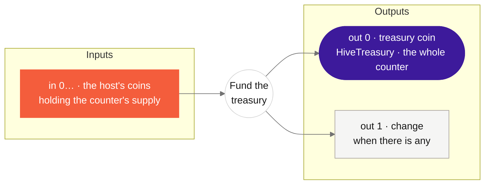
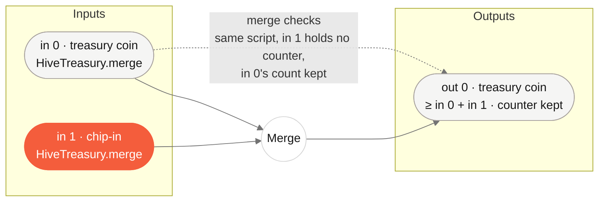
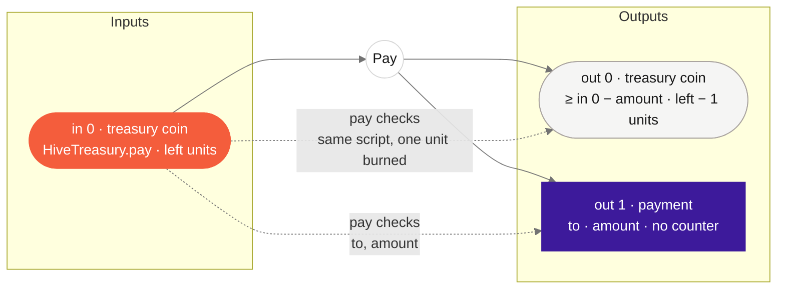
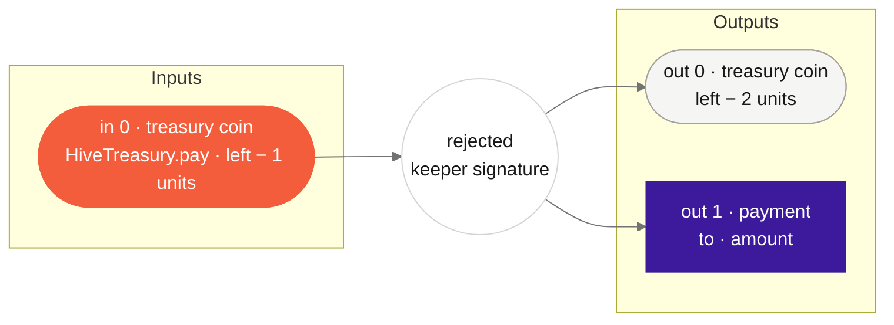
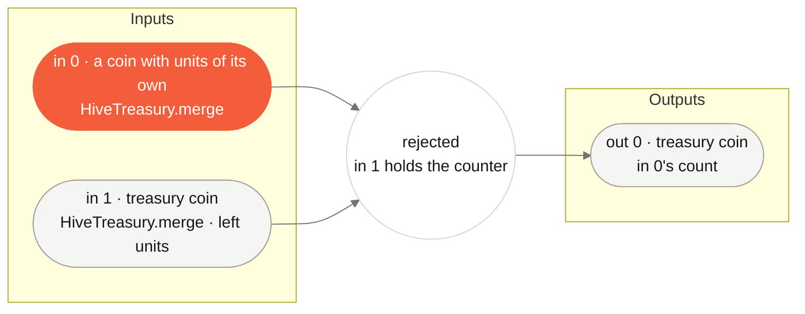

# The v5 treasury

A hive's treasury is one coin on the `HiveTreasury` script, and it holds the hive's counter asset:
a fixed supply issued once, with no control asset, so nobody can issue more. Each payment spends
that coin with `HiveTreasury.pay`, burns one unit of the counter and leaves the change on the same
script. Two of the three keepers approve every payment, each by sending a message in the hive's
Buzz channel, signed by their Buzz identity's key as every message they send is. The two approvals
are independent messages, so keepers approve from their own devices, at different times, in any
order, with no rounds between them.

An approval names the treasury by its counter, the number of units the treasury coin holds when it
pays, the amount, the time it lapses and the recipient's Taproot program. It therefore pays once:
after the payment the coin holds one unit less, and the same approval no longer matches. It pays only
before it lapses, so an approval the keepers stopped waiting for cannot surface later. It names no
coin, so a merge or a renewal, which keep the units, leaves every pending approval valid. It names
the number and not the payment, so the same payment approved under two numbers pays under both: the
hive's desk opens one payment at a time, under the treasury's current number, and a keeper's plugin
offers no second approval of a payment whose first could still pay.

A chip-in, a member's direct send to the treasury's address, is a second coin on the same script
beside the treasury coin, and so is an escrow's remainder or refund. `pay` spends only the coin that
holds the counter. `HiveTreasury.merge` folds the other coin into it, and anyone may submit it. The order of a
merge's inputs is the submitter's, so `merge` holds them to it: the coin folded in carries no unit
of the counter, and the merged coin carries the treasury coin's count, so nothing sent to the
treasury's address can set its payment number. The
host's delegatee renews the treasury coin into a new batch near its expiry with
`HiveTreasury.renew`, and the treasury pays the operator's fee, up to `maxFee`. When the operator is
gone, any two keepers take the coin onchain through `exit01`, `exit02` or `exit12` after
`exitDelay`.

The covenant cannot count the units that exist. That the host issued exactly the supply it sent,
with nothing that can issue more, is what keeps a second coin with units of its own off the
treasury's script, where the same approvals would pay once more from whatever that coin held. The
Operator's indexer reports both facts to anyone who asks (`pnpm ops counter`), and the first
payment's number, which `pay` checks against the coin, shows the treasury was sent the whole supply.

The message each keeper approves is the one `pay` rebuilds:

```
sha256("hive/treasury/pay/v1" ‖ counterTxid ‖ counterGidx (2 bytes) ‖ left (8 bytes) ‖ amount (8 bytes) ‖ validUntil (8 bytes) ‖ to.program ‖ to.version (1 byte))
```

The keeper's approval is a Buzz channel message, a Nostr kind 9 event whose text is exactly
`I approve Hive payment of <amount> sats to <recipient> <code>`: the amount in decimal with no
leading zero, the first eight hex characters of the recipient's program, and the message in
base64url, the payment's code. The words are for the keeper, who reads what they send; the code
binds every byte. `pay` rebuilds the event's NIP-01 serialization from the keeper's key, the amount,
the recipient, the code and the two parts Buzz chooses itself, the event's `created_at` and its
tags, which the keeper's approval carries with the signature:

```
text = "I approve Hive payment of " ‖ amount in decimal ‖ " sats to " ‖ to.program's first 4 bytes in hex ‖ " " ‖ code
id = sha256('[0,"' ‖ keeper's key in hex ‖ '",' ‖ created_at ‖ ',9,' ‖ tags as JSON ‖ ',"' ‖ text ‖ '"]')
```

and checks the keeper's BIP340 signature over `id`. Only the text binds the approval. JSON writes a
quote inside a string as `\"`, so in any event's serialization the last quote not preceded by a
backslash, before the closing `"]`, is the one that opens its content: a message that says anything
more, or carries the approval's words in a tag, has another id.

## Contracts

### HiveTreasury

```
HiveTreasury(bytes keeperA, bytes keeperB, bytes keeperC, bytes hexA, bytes hexB, bytes hexC,
             bytes32 counterTxid, int counterGidx, bytes delegateKey, int renewalWindow,
             int maxFee, pubkey exitA, pubkey exitB, pubkey exitC, int exitDelay)
```

| Parameter | Bound as |
| --- | --- |
| `keeperA`, `keeperB`, `keeperC` | Each keeper's Buzz key, x-only, which `pay` checks with `checkSigFromStack`. |
| `hexA`, `hexB`, `hexC` | The same keys as Buzz writes them in every event, 64 lowercase hex characters, for rebuilding the keeper's message. |
| `counterTxid`, `counterGidx` | The counter asset, in the Emulator's byte order: the treasury's identity in every approval. |
| `delegateKey` | The host's delegatee key as an intent names its cosigner: the only cosigner `renew` accepts. |
| `renewalWindow` | How long before the coin's expiry `renew` opens. |
| `maxFee` | The most a renewal pays the operator, in sats. |
| `exitA`, `exitB`, `exitC` | Each keeper's Buzz key once more, as the exit leaves check it with `OP_CHECKSIG`: 33 bytes, `02` and the x-only key, which the leaf pushes x-only. |
| `exitDelay` | The relative delay before an exit leaf can spend. |

`pay` and `merge` pay the change or the merged coin to this script, and the next `pay` spends that
continuation.

Every keeper key here is a Buzz identity's own public key, used as Buzz signs with it; the
repository's README explains [where those keys come from and how the treasury is built from
them](../../README.md#from-a-buzz-identity-to-the-treasury).

## Functions

A `require` checks the transaction. It does not identify who may move the coins.

### HiveTreasury

**pay**(amount, to, validUntil, sigs, times, tags) `covenant`

The payment runs in an offchain transaction. The server and the function-tweaked emulator cosign it,
so anyone holding two keepers' approvals can submit it, and those approvals, checked with
`checkSigFromStack`, are part of the transaction. The keepers do not sign the transaction itself.

- `!tx.intent.has("type")`: offchain, not in an intent.
- `!checkTime(validUntil)`: the approvals have not lapsed.
- `tx.numInputs == 1` and `tx.numOutputs == 4`: the treasury coin; change, payment, the extension and the anchor.
- `amount >= 330` and `amount < 1000000000000`, so the text names it in at most twelve digits.
- `left = tx.inputs[0].assets.lookup(counterTxid, counterGidx)` and `left > 1`.
- For each keeper with a signature: `created_at` is at most ten characters, and `checkSigFromStack`
  on that keeper's key over the id of their kind 9 message
  `I approve Hive payment of <amount> sats to <recipient> <code>`.
- At least two keepers' signatures verify.
- `tx.outputs[0].script == tx.input.current.script`.
- `tx.outputs[0].value >= tx.input.current.value - amount`.
- `tx.outputs[0].assets.lookup(counterTxid, counterGidx) == left - 1`.
- `tx.outputs[1].script == to` and `tx.outputs[1].value == amount`.
- `!tx.outputs[1].assets.has(counterTxid, counterGidx)`.

**merge**() `covenant`

The merge runs in an offchain transaction. The server and the function-tweaked emulator cosign it,
anyone can build it, and no person signs.

- `!tx.intent.has("type")`.
- `tx.numInputs == 2`, and both inputs' scripts are `tx.input.current.script`.
- `tx.numOutputs == 3`: the merged coin, the extension and the anchor.
- `tx.outputs[0].script == tx.input.current.script`.
- `tx.outputs[0].value >= tx.inputs[0].value + tx.inputs[1].value`.
- `!tx.inputs[1].assets.has(counterTxid, counterGidx)`: the coin folded in holds no unit of the counter.
- `tx.outputs[0].assets.lookup(counterTxid, counterGidx) == tx.inputs[0].assets.lookup(counterTxid, counterGidx)`,
  which fails when input 0 holds none: the treasury coin is input 0, whoever submits.

**renew**() `covenant`

The renewal runs in the intent proof the host's delegatee registers for a batch. The server and the
function-tweaked emulator cosign the proof, and the delegatee is the only cosigner of the new batch's tree.

- `checkTime(this.expiry - renewalWindow)`.
- `tx.intent.field("type") == "register"` and `tx.intent.field("onchain_output_indexes") == "[]"`.
- `tx.intent.field("cosigners_public_keys.0") == delegateKey`, and `!tx.intent.has("cosigners_public_keys.1")`.
- `this.tunnel(k, {script: true, value: false, assets: true})` for proof output `k`, one before this input.
- `tx.outputs[k].value + maxFee >= tx.input.current.value`.

**exit01**(sigA, sigB) `tapscript`

The exit runs onchain after the treasury coin's branch is published. After `older(exitDelay)`,
keepers 0 and 1 each sign the spend with their own Buzz key, and the leaf checks both signatures
(`<exitA> OP_CHECKSIGVERIFY <exitB> OP_CHECKSIG`). `exit02` and `exit12` are the same leaf for the
other two pairs. The two signatures are independent: each keeper signs the transaction alone, at
any time, with no rounds between them, as they approve payments.

Enforced: two keepers approve each payment, its amount, its recipient, its number and its lapse
time, in a message that says the amount and the start of the recipient; an approval pays once under
the number it names, and only before it lapses; the change and the counter stay on the treasury
script; a merge keeps every sat and the treasury coin's count, whatever the order of its inputs, and
folds in no coin that holds the counter; a renewal keeps the script and the counter and pays at most
`maxFee`; only the delegatee cosigns a renewal; payments and merges never run in an intent.

Not claimed: that the keepers approve the right payment, or the same payment under one number only,
which the desk and the plugin see to; that the counter's supply is the one the treasury was sent,
which the issuance decides and the indexer reports; that the delegatee renews in time, that the
operator stays online, and where the recipient's program sends the coins afterwards. The Emulator
runs these checks before it signs, and reads the lapse time from its own clock: Bitcoin's rules see
the Operator's and the Emulator's signatures only.

## Transactions

### Funding

The host issues the counter from its own coins and sends the whole supply to the treasury's
address, which is a new coin on `HiveTreasury`. No function of the treasury runs here.



### Merge a chip-in

Input 0 is the treasury coin and input 1 a chip-in or an escrow's remainder, both on `HiveTreasury`,
and `HiveTreasury.merge` runs on each. Input 1 holds no unit of the counter. All the sats and the
treasury coin's count land in one coin on the same script.



### Pay

The treasury coin is the only input, and `HiveTreasury.pay` runs on it with two keepers' approvals.
`amount` goes to the program the keepers approved, the rest stays on the treasury script, and one
unit of the counter is burned.



### Renewal

The delegatee's intent proof spends the treasury coin as proof input 1 with `HiveTreasury.renew`,
and proof output 0 is the coin it continues as in the new batch, with the same script and counter.
The operator's fee is the difference, at most `maxFee`.


### Exit

With the operator gone, the keepers publish the path from the batch output to the treasury coin, and
after `exitDelay` two keepers spend it onchain, each with a signature from their own Buzz key. No
covenant runs, and the leaf does not constrain the outputs.


### Refused: a replayed approval

The same approvals presented again after their payment. The treasury coin now holds one unit less,
so `pay` rebuilds a different message and neither keeper's signature verifies. The picture may not
balance: the spend never happens.



### Refused: a merge that would set the count

A coin on the treasury's script that holds units of the counter itself, merged in front of the
treasury coin so that its count would become the treasury's: a count set back to a number already
paid would let that payment's approvals pay again. `merge` refuses it with the coins in either
order, since the coin at input 1 may hold no unit. The picture may not balance: the spend never
happens.


