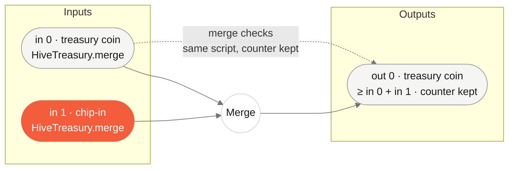
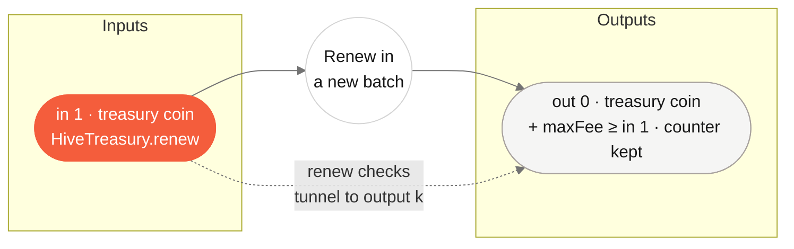
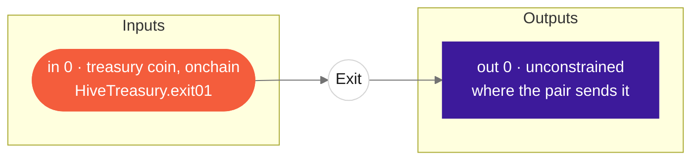

# The v5 treasury

A hive's treasury is one coin on the `HiveTreasury` script, and it holds the hive's counter asset:
a fixed supply issued once, with no control asset, so nobody can issue more. Each payment spends
that coin with `HiveTreasury.pay`, burns one unit of the counter and leaves the change on the same
script. Two of the three keepers approve every payment, each with a P-256 key of their own: a
passkey, whose approval is a WebAuthn assertion, or a raw P-256 key such as one in a Secure
Enclave. The two approvals are independent signatures, so keepers approve from their own devices,
at different times, in any order, with no rounds between them.

An approval names the treasury by its counter, the number of units the treasury coin holds when it
pays, the amount, the time it lapses and the recipient's Taproot program. It therefore pays once:
after the payment the coin holds one unit less, and the same approval no longer matches. It pays only
before it lapses, so an approval the keepers stopped waiting for cannot surface later. It names no
coin, so a merge or a renewal, which keep the units, leaves every pending approval valid.

A chip-in, a member's direct send to the treasury's address, is a second coin on the same script
beside the treasury coin, and so is an escrow's remainder or refund. `pay` spends only the coin that
holds the counter. `HiveTreasury.merge` folds the other coin into it, and anyone may submit it. The
host's delegatee renews the treasury coin into a new batch near its expiry with
`HiveTreasury.renew`, and the treasury pays the operator's fee, up to `maxFee`. When the operator is
gone, any two keepers take the coin onchain through `exit01`, `exit02` or `exit12` after
`exitDelay`.

The message each keeper approves is the one `pay` rebuilds:

```
sha256("hive/treasury/pay/v1" ‖ counterTxid ‖ counterGidx (2 bytes) ‖ left (8 bytes) ‖ amount (8 bytes) ‖ validUntil (8 bytes) ‖ to.program ‖ to.version (1 byte))
```

A passkey signs `sha256(authData ‖ sha256(clientDataJSON))`, and `pay` rebuilds `clientDataJSON` as
`{"type":"webauthn.get","challenge":"` followed by the message in base64url and the rest of the
browser's JSON, which the keeper passes with the signature. A raw key signs `sha256(message)`.

## Contracts

### HiveTreasury

```
HiveTreasury(bytes keeperA, bytes keeperB, bytes keeperC, int kindA, int kindB, int kindC,
             bytes32 siteA, bytes32 siteB, bytes32 siteC, bytes32 counterTxid, int counterGidx,
             bytes delegateKey, int renewalWindow, int maxFee, pubkey pair01, pubkey pair02,
             pubkey pair12, int exitDelay)
```

| Parameter | Bound as |
| --- | --- |
| `keeperA`, `keeperB`, `keeperC` | Each keeper's P-256 key, `0x11` and the compressed point, which `pay` checks with `checkSigFromStack`. |
| `kindA`, `kindB`, `kindC` | 1 when that keeper's key is a passkey, 2 when it is a raw P-256 key. |
| `siteA`, `siteB`, `siteC` | sha256 of the domain each keeper's passkey belongs to, the console's site where they made it: that keeper's assertion counts only for that site. |
| `counterTxid`, `counterGidx` | The counter asset, in the Emulator's byte order: the treasury's identity in every approval. |
| `delegateKey` | The host's delegatee key as an intent names its cosigner: the only cosigner `renew` accepts. |
| `renewalWindow` | How long before the coin's expiry `renew` opens. |
| `maxFee` | The most a renewal pays the operator, in sats. |
| `pair01`, `pair02`, `pair12` | One MuSig2 key per pair of keepers, over the Bitcoin keys their passkeys derive. |
| `exitDelay` | The relative delay before an exit leaf can spend. |

`pay` and `merge` pay the change or the merged coin to this script, and the next `pay` spends that
continuation.

## Functions

A `require` checks the transaction. It does not identify who may move the coins.

### HiveTreasury

**pay**(amount, to, validUntil, sigs, authData, clientTails) `covenant`

The payment runs in an offchain transaction. The server and the function-tweaked emulator cosign it,
so anyone holding two keepers' approvals can submit it, and those approvals, checked with
`checkSigFromStack`, are part of the transaction. The keepers do not sign the transaction itself.

- `!tx.intent.has("type")`: offchain, not in an intent.
- `!checkTime(validUntil)`: the approvals have not lapsed.
- `tx.numInputs == 1` and `tx.numOutputs == 4`: the treasury coin; change, payment, the extension and the anchor.
- `amount >= 330`.
- `left = tx.inputs[0].assets.lookup(counterTxid, counterGidx)` and `left > 1`.
- For each keeper with a signature: for a passkey, `authData` starts with that keeper's site hash, its flags have
  the user present and verified bits, and the client data's tail starts with `"`; then
  `checkSigFromStack` on that keeper's key over the WebAuthn digest, or over `sha256(message)` for a raw key.
- At least two keepers' signatures verify.
- `tx.outputs[0].script == tx.input.current.script`.
- `tx.outputs[0].value >= tx.input.current.value - amount`.
- `tx.outputs[0].assets.lookup(counterTxid, counterGidx) == left - 1`.
- `tx.outputs[1].script == to` and `tx.outputs[1].value == amount`.
- `!tx.outputs[1].assets.has(counterTxid, counterGidx)`.

**merge**() `covenant`

The merge runs in an offchain transaction. The server and the function-tweaked emulator cosign it,
anyone can build it, and no person signs.

- `!tx.intent.has("type")`.
- `tx.numInputs == 2`, and both inputs' scripts are `tx.input.current.script`.
- `tx.numOutputs == 3`: the merged coin, the extension and the anchor.
- `tx.outputs[0].script == tx.input.current.script`.
- `tx.outputs[0].value >= tx.inputs[0].value + tx.inputs[1].value`.
- `tx.outputs[0].assets.lookup(counterTxid, counterGidx) == tx.inputs[0].assets.lookup(counterTxid, counterGidx)`.

**renew**() `covenant`

The renewal runs in the intent proof the host's delegatee registers for a batch. The server and the
function-tweaked emulator cosign the proof, and the delegatee is the only cosigner of the new batch's tree.

- `checkTime(this.expiry - renewalWindow)`.
- `tx.intent.field("type") == "register"` and `tx.intent.field("onchain_output_indexes") == "[]"`.
- `tx.intent.field("cosigners_public_keys.0") == delegateKey`, and `!tx.intent.has("cosigners_public_keys.1")`.
- `this.tunnel(k, {script: true, value: false, assets: true})` for proof output `k`, one before this input.
- `tx.outputs[k].value + maxFee >= tx.input.current.value`.

**exit01**(pairSig) `tapscript`

The exit runs onchain after the treasury coin's branch is published. Keepers 0 and 1 sign with
their pair's MuSig2 key, `pair01`, after `older(exitDelay)`. `exit02` and `exit12` are the same leaf
for the other two pairs.

Enforced: two keepers approve each payment, its amount, its recipient, its number and its lapse
time; an approval pays once, and only before it lapses; the change and the counter stay on the treasury script; a merge keeps every sat and the
counter; a renewal keeps the script and the counter and pays at most `maxFee`; only the delegatee
cosigns a renewal; payments and merges never run in an intent.

Not claimed: that the keepers approve the right payment, that the delegatee renews in time, that
the operator stays online, and where the recipient's program sends the coins afterwards.

## Transactions

### Funding

The host issues the counter from its own coins and sends the whole supply to the treasury's
address, which is a new coin on `HiveTreasury`. No function of the treasury runs here.


### Merge a chip-in

Input 0 is the treasury coin and input 1 a chip-in or an escrow's remainder, both on `HiveTreasury`,
and `HiveTreasury.merge` runs on each. All the sats and the whole counter land in one coin on the
same script.



### Pay

The treasury coin is the only input, and `HiveTreasury.pay` runs on it with two keepers' approvals.
`amount` goes to the program the keepers approved, the rest stays on the treasury script, and one
unit of the counter is burned.


### Renewal

The delegatee's intent proof spends the treasury coin as proof input 1 with `HiveTreasury.renew`,
and proof output 0 is the coin it continues as in the new batch, with the same script and counter.
The operator's fee is the difference, at most `maxFee`.



### Exit

With the operator gone, the keepers publish the path from the batch output to the treasury coin, and
after `exitDelay` one pair spends it onchain with its MuSig2 key. No covenant runs, and the leaf does
not constrain the outputs.



### Refused: a replayed approval

The same approvals presented again after their payment. The treasury coin now holds one unit less,
so `pay` rebuilds a different message and neither keeper's signature verifies. The picture may not
balance: the spend never happens.


