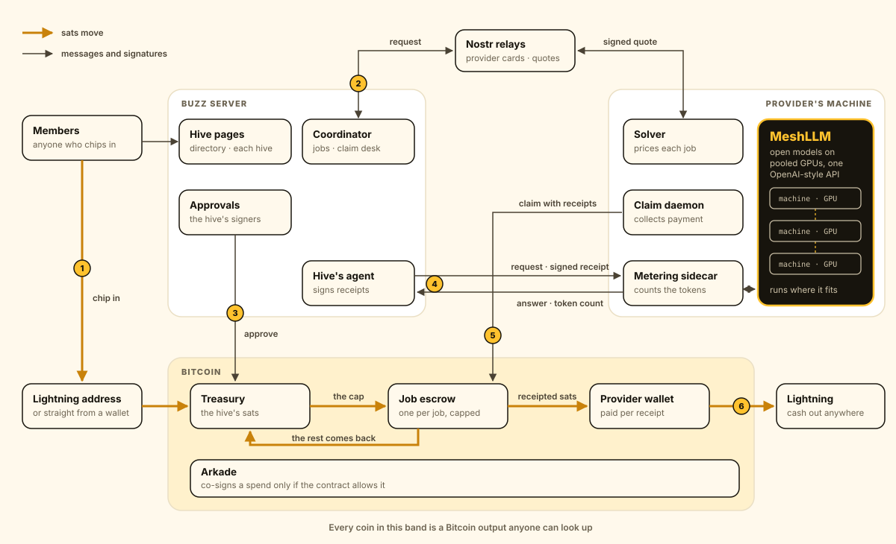

# How Hive works

The Buzz server runs the hive, MeshLLM does the AI work on the provider's
machines, and every sat in between sits in Bitcoin contracts: the treasury, one
escrow per job and each provider's wallet. The server and MeshLLM exchange
messages and signatures, and the contracts decide what those signatures can
move.

## One job, start to finish

1. **Chip in.** Members pay the hive's Lightning address, which lands in the
   treasury as a swap, or send straight from a wallet. A contribution counts
   once the coin is seen.
2. **Ask for a quote.** The coordinator asks a provider's solver over Nostr. The
   provider answers with a signed quote: model, price per token, cap and
   deadline.
3. **Fund the job.** The hive approves the job, and the treasury moves exactly
   the cap into an escrow built from that quote.
4. **Do the work.** The hive's agent sends requests through the provider's
   sidecar to MeshLLM. The sidecar counts the tokens MeshLLM reports, and the
   agent signs a receipt for every answer.
5. **Get paid.** The claim daemon presents the latest receipt. The escrow pays
   that amount to the provider's wallet and sends the rest back to the
   treasury; an unclaimed escrow returns whole at its deadline.
6. **Cash out.** The provider pays any Lightning invoice from its wallet through
   a swap, or keeps the sats in its wallet for later.

## Who does what

- **Buzz server.** Serves the hive pages, finds providers, coordinates jobs and
  runs the hive's agent. It holds no coins.
- **MeshLLM.** Serves open models on GPUs pooled across machines, behind one
  OpenAI-style API. The provider's sidecar meters it from the outside, and Hive
  never changes MeshLLM itself.
- **Arkade.** Co-signs a spend from the treasury, an escrow or a wallet only
  when that contract allows it, so a signature can move only what the contract
  says it may.
- **Nostr relays.** Carry provider cards, quote requests and quotes, and the
  hives' own listings.

## Hives and hosts

One server can host many hives, each at `/h/<hive>/` with its own treasury,
records, payment requests, claim queue and halt switch. The directory at `/`
lists each hive under a listing signed with its treasury's keys: name,
purpose, keys, treasury and Lightning address. The host refuses a listing those
keys never signed, two hives with one name and two hives with one treasury.

Listings also go to Nostr relays, published the same way providers publish
their cards, so other sites and providers can find hives without any one host.
Anyone may republish a listing. A reader keeps it only when the keys it names
build the treasury it names, and shows the newest one per treasury, so a
listing pointing at someone else's treasury never appears.

The [safeguards](../README.md#safeguards) say what the contracts guarantee, and
[running Hive](running.md) covers the commands.
